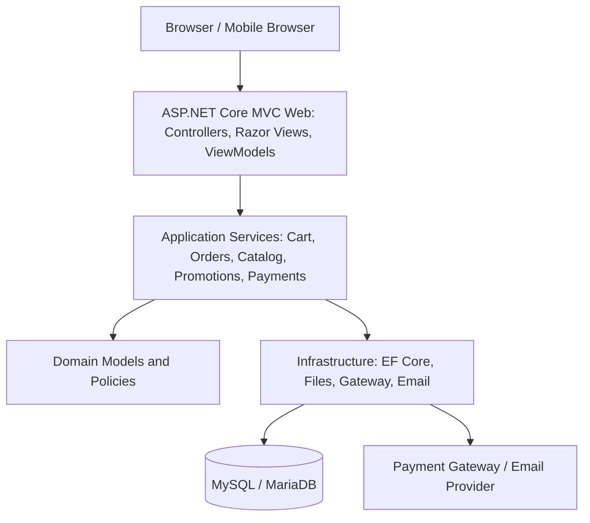

# AarMaabd — Architecture and Folder Rules

## 1. Architectural style

**Modular monolith with ASP.NET Core MVC**: one deployable web application, clear feature/services boundaries, relational data in MySQL or a compatible MariaDB instance. Use Razor `.cshtml`, Bootstrap 5 and plain JavaScript. Keep complexity proportional to a beginner-maintainable project. Avoid microservices, CQRS/event buses, generic repository layers and elaborate patterns until a demonstrated requirement justifies them.

### Logical layers and dependency directions



**Allowed:** MVC controllers depend on application service interfaces; services depend on domain types and infrastructure abstractions; infrastructure implements abstractions. **Not allowed:** Razor Views query DB, controllers directly perform complex order/payment business logic, models call web/payment APIs, or payment callbacks trust browser-supplied amounts.

### Layer responsibilities

| Layer | Owns | Must not do |
|---|---|---|
| Presentation (MVC) | Routing, model binding, authorization attributes, validation feedback, ViewModels, Razor HTML | SQL, payment decisions, large business workflows |
| Application | Use cases; cart/order/promotion/payment orchestration, transaction boundary decisions | Return HTML or depend on request-specific UI widgets |
| Domain | Entities, enums, invariant rules, pricing definitions | Read request/session, depend on EF or web API |
| Infrastructure | EF Core DbContext/migrations, gateway adapters, image storage, email, logging integration | Decide user-facing product policy independently |
| Tests | Unit/integration/concurrency/security/e2e checks | Replace actual release verification |

## 2. Recommended project layout

Start with **one ASP.NET Core MVC project** to keep development beginner-friendly. Make conceptual layers with folders and interfaces; split into class libraries only when the team needs it.

```text
AarMaabd.sln
src/
  AarMaabd.Web/
    Areas/
      Admin/
        Controllers/
          DashboardController.cs
          ProductsController.cs
          CategoriesController.cs
          OrdersController.cs
          PromotionsController.cs
          CouponsController.cs
          InventoryController.cs
          CustomersController.cs
          PaymentsController.cs
          BannersController.cs
          SettingsController.cs
        Views/{Dashboard,Products,Categories,Orders,Promotions,Coupons,...}/
        ViewModels/
    Controllers/
      HomeController.cs
      ShopController.cs
      ProductsController.cs
      CartController.cs
      CheckoutController.cs
      OrdersController.cs
      AccountController.cs
      WishlistController.cs
      CustomOrdersController.cs
      PaymentsController.cs
    Models/
      ApplicationUser.cs
      Category.cs
      Product.cs
      ProductImage.cs
      ProductVariant.cs
      Order.cs
      OrderItem.cs
      Payment.cs
      Coupon.cs
      Promotion.cs
      InventoryMovement.cs
    ViewModels/
      Products/
      Cart/
      Checkout/
      Account/
    Services/
      Interfaces/
      CatalogService.cs
      CartService.cs
      CheckoutService.cs
      OrderService.cs
      InventoryService.cs
      PricingService.cs
      PromotionService.cs
      PaymentService.cs
    Data/
      ApplicationDbContext.cs
      EntityConfigurations/
      Migrations/
      Seed/
    Integrations/
      Payments/
      Email/
      FileStorage/
    Middleware/
    Authorization/
      Policies.cs
    Views/
      Shared/_Layout.cshtml
      Shared/_ValidationScriptsPartial.cshtml
      Home/
      Shop/
      Products/
      Cart/
      Checkout/
      Orders/
      Account/
    wwwroot/
      css/site.css
      js/site.js
      images/branding/
    Program.cs
    appsettings.json
    appsettings.Development.json
  AarMaabd.Tests/
    Unit/
    Integration/
    Security/
    Concurrency/
docs/
  ARCHITECTURE.md
  SECURITY_AUTHORIZATION.md
  DATABASE_RULES.md
  ERROR_HANDLING_OBSERVABILITY.md
  UI_UX_RULES.md
  PROJECT_RULES.md
  DEPENDENCIES_ENVIRONMENT.md
```

**File rule:** Uploaded images should live in dedicated, validated managed storage (not blindly in `wwwroot/uploads`); serve them via safe public identifiers or configured object storage. Never store secrets in `wwwroot` or committed `appsettings.json`.

## 3. Responsibilities / controllers

- Public `Home/Shop/Products`: discovery, category menus, product detail, search, filters, pagination.
- `Account`: Identity register/login/logout/forgot password/profile. Use Identity built-in APIs, not custom password encryption.
- `Cart/Checkout/Orders`: item updates, re-price server-side, delivery quote, place order, confirmation/history/tracking.
- `Payments`: only gateway return/callback/webhook endpoints with **server-side confirmation and idempotent processing**; no sensitive card collection.
- `CustomOrders`: requests/quotes/lead times; secure image uploads.
- Admin `Products/Categories/Inventory`: dynamic catalog CRUD, valid stock operations, archive instead of unsafe deletes.
- Admin `Orders/Payments`: order status transitions and verified payment monitoring.
- Admin `Promotions/Coupons`: fixed/percentage discounts, eligibility, time windows, stacking and usage limits.
- Admin `Banners/Settings`: manage homepage promotions and approved store settings; sensitive secrets remain server configuration, **never** editable in regular CMS text fields.

Admin controllers require `[Area("Admin")]` and `[Authorize(Roles = "Admin")]` (or stricter policy) at controller/area scope. **Never assume an Admin link being hidden is authorization.**

## 4. Dependency direction rules

1. Controller → Service → DbContext (via service): preferred for non-trivial features.
2. Razor View → ViewModel only; never directly rely on `DbContext`.
3. Application services cannot use `HttpContext` implicitly for customer identity; pass verified user/tenant identifiers from controller after authorization.
4. Integration clients are behind interfaces, configurable and mockable in tests.
5. `DbContext` uses request-scoped lifetime. Do not use as static or singleton, and do not share a DbContext across concurrent tasks.
6. Services should remain small enough to unit test; split by business capability when necessary.
7. The server is the source of truth for price, totals, discounts, stock and status; never trust form-hidden values.

## 5. Checkout sequence / invariant

```mermaid
sequenceDiagram
  participant C as Customer
  participant MVC as Checkout Controller
  participant S as Checkout/Order Service
  participant DB as MySQL
  participant G as Payment Gateway
  C->>MVC: Submit validated checkout
  MVC->>S: Place order (idempotency key)
  S->>DB: Begin short transaction; re-price; check stock; reserve/update atomically; save pending order
  DB-->>S: Commit or conflict
  S-->>MVC: Order reference
  alt COD
    MVC-->>C: Confirm pending order (payment Unpaid)
  else Online
    MVC->>G: Initiate hosted checkout with server-computed amount
    G-->>C: Hosted payment screen
    G->>MVC: Callback/return notification
    MVC->>G: Independently verify payment
    MVC->>S: Apply payment event once
    S->>DB: Save transaction/state idempotently
  end
```

**Critical:** Do not hold a DB transaction open during external payment. Define inventory reservation expiry, cancellation and compensation/release rules for failed/expired payments. Stock ownership and payment idempotency are enforced in DB, not only by button disabling.

## 6. Cross-cutting design

- Configuration via strongly typed options (`IOptions<T>`); validate on startup where reasonable.
- Error handling by centralized middleware; localized validation messages.
- Logging uses correlation/request IDs and avoids personal/payment secrets.
- UI and JSON endpoints return appropriate success/error responses.
- Every entity has creation/update timestamps in UTC where applicable; display local time (Asia/Dhaka) in UI.
- Every query over growing lists uses filtering, sorting and pagination.
- Code review requires tests for authorization, pricing and transitions before merge.
